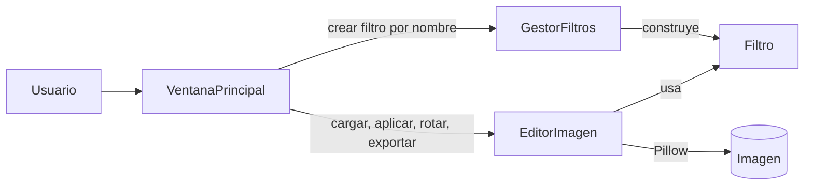
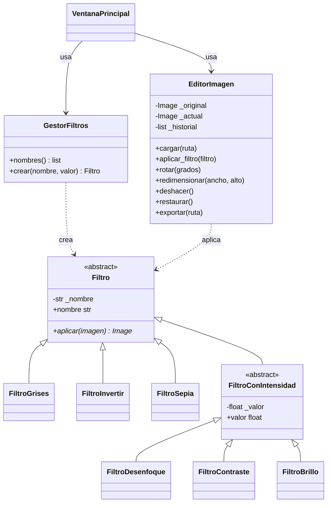

# Informe Técnico — Editor de Imágenes POO

## 1. Análisis del problema

**Necesidad:** muchas personas solo necesitan retoques básicos (filtros, rotar, cambiar tamaño) y no un editor profesional. Se busca una herramienta ligera y fácil de usar.

**Público objetivo:** estudiantes y usuarios generales que quieren editar fotos rápidamente.

**Funcionalidades:** abrir imagen, aplicar filtros, rotar, redimensionar, deshacer/restaurar y exportar.

**Limitaciones:** no guarda proyectos ni capas; el historial vive solo en memoria (máximo 20 pasos); no edita por regiones ni dibuja. Esto es intencional: el enunciado valora una aplicación pequeña y completa.

## 2. Diseño inicial

Antes de programar se identificaron las clases y sus responsabilidades:

| Clase | Responsabilidad |
|-------|-----------------|
| `Filtro` (abstracta) | Define el contrato `aplicar(imagen)`. |
| `FiltroGrises`, `FiltroInvertir`, `FiltroSepia` | Filtros sin parámetros. |
| `FiltroConIntensidad` (abstracta) | Reúne la validación del valor numérico de los filtros parametrizados. |
| `FiltroDesenfoque`, `FiltroContraste`, `FiltroBrillo` | Filtros con parámetro validado. |
| `EditorImagen` | Guarda la imagen original/actual, el historial y ejecuta las operaciones. |
| `GestorFiltros` | Catálogo que crea filtros a partir de su nombre. |
| `VentanaPrincipal` | Interfaz gráfica: muestra controles y reacciona a eventos. |
| `ErrorEditor` y derivadas | Representan los errores previsibles. |

## 3. Arquitectura

El código se separa en tres capas:

- **Modelos (`modelos/`)**: entidades y lógica de imágenes. No dependen de la interfaz.
- **Servicios (`servicios/`)**: `GestorFiltros` conecta la interfaz con los filtros sin que ella conozca las clases concretas.
- **Interfaz (`interfaz/`)**: solo muestra y captura eventos; delega todo en el editor y el gestor.

`main.py` crea los objetos (`EditorImagen`, `GestorFiltros`) y se los entrega a `VentanaPrincipal` por el constructor (inyección de dependencias), lo que permite probar la lógica sin abrir ninguna ventana.



## 4. Diagrama de clases



## 5. Aplicación de POO

| Concepto | Clase o método | Archivo | Explicación |
|----------|----------------|---------|-------------|
| Clases y objetos | `EditorImagen`, `GestorFiltros`, `VentanaPrincipal` | `modelos/editor_imagen.py`, `servicios/gestor_filtros.py`, `interfaz/ventana_principal.py` | Cada clase tiene una responsabilidad. `main.py` crea los objetos y los conecta. |
| Encapsulamiento | `EditorImagen._actual`, `_original`, `_historial`; propiedad `imagen_actual`; setter `FiltroConIntensidad.valor` | `modelos/editor_imagen.py`, `modelos/filtros_concretos.py` | Los atributos son privados. `imagen_actual` devuelve una **copia** para que nadie altere el estado interno, y el setter de `valor` rechaza números fuera de rango. |
| Herencia | `FiltroGrises`, `FiltroDesenfoque`, `FiltroContraste`, `FiltroBrillo`… | `modelos/filtros_concretos.py` | Heredan de `Filtro` y llaman a `super().__init__()`. `FiltroConIntensidad` es una clase intermedia que reutiliza la validación en los tres filtros parametrizados. |
| Polimorfismo | `aplicar()` | `modelos/filtro.py`, `modelos/filtros_concretos.py` | `EditorImagen.aplicar_filtro()` llama a `filtro.aplicar()` sin saber qué filtro es; cada clase responde con su propio comportamiento. |
| Abstracción | `Filtro` (con `ABC` y `@abstractmethod`) | `modelos/filtro.py` | Establece el contrato "todo filtro recibe una imagen y devuelve otra". No se puede instanciar directamente (probado en `test_filtro_es_abstracto`). |
| Asociación | `VentanaPrincipal` → `EditorImagen` y `GestorFiltros` | `interfaz/ventana_principal.py` | La ventana usa ambos objetos, pero no los crea ni son parte de ella; los recibe en el constructor. |
| Composición | `EditorImagen` y sus imágenes (`_original`, `_actual`, `_historial`) | `modelos/editor_imagen.py` | Las imágenes que guarda el editor existen solo mientras el editor las contiene; el editor es su dueño. |
| Dependencia | `GestorFiltros` → clases de filtros | `servicios/gestor_filtros.py` | El gestor crea filtros bajo demanda; la interfaz no conoce las clases concretas. |

Fragmento representativo del polimorfismo:

```python
# EditorImagen no sabe qué filtro recibe: solo exige que cumpla el contrato.
def aplicar_filtro(self, filtro: Filtro) -> None:
    self._exigir_imagen()
    nueva = filtro.aplicar(self._actual)
    self._guardar_historial()
    self._actual = nueva
```

## 6. Construcción de la interfaz

- **Biblioteca:** CustomTkinter (sobre Tkinter), por su aspecto moderno y porque permite programación orientada a eventos con poco código.
- **Diseño:** panel lateral con herramientas a la izquierda y zona de vista previa con barra de estado a la derecha.
- **Controles:** botones (abrir, guardar, aplicar, rotar, deshacer, restaurar), lista desplegable de filtros, deslizador de intensidad y campos de texto para ancho y alto.
- **Eventos y callbacks:** cada control tiene un callback (`_al_abrir`, `_al_aplicar_filtro`, `_al_rotar`…) asignado con `command=`. El deslizador actualiza su etiqueta al moverse y la lista de filtros muestra u oculta el deslizador según el filtro elegido.
- **Comunicación con las clases:** todos los callbacks pasan por `_ejecutar()`, que llama al modelo, captura `ErrorEditor` y muestra un mensaje si algo falla. La ventana no contiene lógica de procesamiento de imágenes.

**Capturas:**


## 7. Proceso de desarrollo

1. **Formulación de la idea:** se eligió un editor de imágenes porque los filtros se modelan de forma natural con clases.
2. **Identificación de funcionalidades:** abrir, filtrar, transformar, guardar y deshacer.
3. **Diseño de clases:** se definió el contrato `Filtro` y las responsabilidades de cada clase.
4. **Construcción de la lógica:** se programaron modelos y servicios sin interfaz, probándolos desde el inicio.
5. **Desarrollo de la interfaz:** se construyó la ventana y se conectaron los callbacks.
6. **Integración:** `main.py` une las piezas.
7. **Pruebas y correcciones:** pruebas automáticas y manuales; se corrigieron los problemas descritos en la sección 9.

## 8. Pruebas

**Pruebas automáticas:** 18 pruebas en `pruebas/test_editor.py`, todas aprobadas (`python -m unittest discover -s pruebas -t . -v`).

**Pruebas de funcionamiento documentadas:**

| Prueba | Acción realizada | Resultado esperado | Resultado obtenido |
|--------|------------------|--------------------|--------------------|
| Prueba 1 | Abrir una imagen PNG válida de 40×20 px | La imagen se carga y el tamaño es 40×20 | Correcto (`test_cargar_imagen_valida`) |
| Prueba 2 | Aplicar el filtro de grises a una imagen roja | Los tres canales RGB quedan iguales | Correcto (`test_grises_deja_canales_iguales`) |
| Prueba 3 | Rotar 90° una imagen de 40×20 | El tamaño pasa a 20×40 | Correcto (`test_rotar_intercambia_dimensiones`) |
| Prueba 4 (error) | Intentar abrir un archivo de texto con extensión `.png` | Se rechaza con `ArchivoInvalidoError`, sin cerrar el programa | Correcto (`test_cargar_archivo_que_no_es_imagen`) |
| Prueba 5 (error) | Redimensionar con ancho `"abc"` o `0` | Se rechaza con `ParametroInvalidoError` | Correcto (`test_redimensionar_invalido`) |
| Prueba 6 (error) | Crear un contraste con valor 10 (máximo 3) | Se rechaza con `ParametroInvalidoError` | Correcto (`test_contraste_fuera_de_rango`) |
| Prueba 7 (interfaz) | Pulsar *Aplicar filtro* sin imagen cargada | Aparece un aviso "Primero debe cargar una imagen" | Correcto: apareció el aviso y el programa siguió funcionando |

## 9. Problemas y soluciones


**Problema 1: los comandos `pip`, `python` y `py` no funcionaban.**
- *Diagnóstico:* Python no estaba instalado en el equipo; Windows solo tenía un acceso directo a la Microsoft Store.
- *Solución:* se ejecutó `python -m pip install -r requirements.txt`, que activó el instalador de Python de Windows y dejó instalado Python 3.15 con sus dependencias.

## 10. Conclusiones

El proyecto permitió aplicar los conceptos del semestre en un caso concreto: el contrato abstracto `Filtro` hace que agregar un filtro nuevo sea tan simple como crear una clase y registrarla en el `GestorFiltros`, sin tocar el editor ni la interfaz. Separar la lógica de la interfaz facilitó las pruebas y los cambios. La mayor dificultad fue manejar los errores de forma que el usuario reciba mensajes claros sin que el programa se cierre.

**Mejoras posibles:** vista previa en tiempo real del filtro antes de aplicarlo, más filtros (nitidez, bordes), recorte de imagen y arrastrar-y-soltar para abrir archivos.
